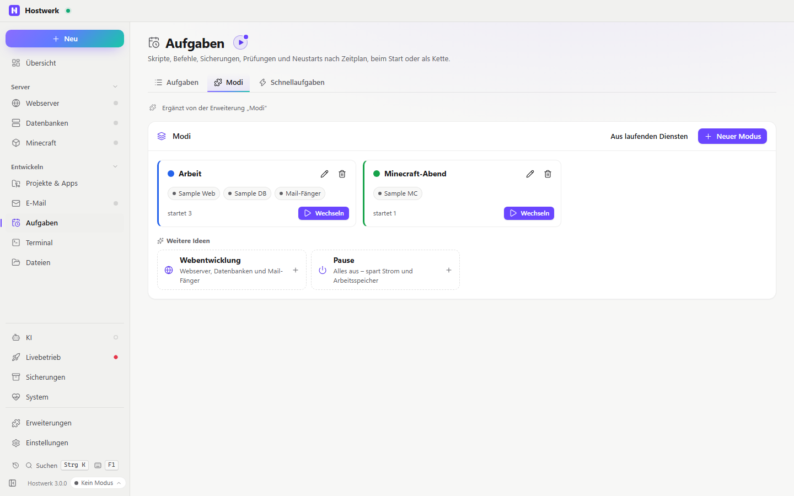

# Modi

Dienste für eine Aufgabe mit einem Klick: „Arbeit“ mit Webserver und Datenbank, „Minecraft-Abend“ nur mit dem Server. Wechseln startet genau diese Dienste und stoppt die anderen – auch beim Start von Hostwerk.

[English](README.md) · Offizielle [Hostwerk](https://github.com/Passimoritz/hostwerk-public)-Erweiterung (SDK 3.3, native Erweiterung)



## Was sie kann

- **Wo:** Aufgaben → Modi, der Umschalter auf der Übersicht (neben „Anpassen“) und unten in der Seitenleiste – ohne eigenen Seitenleisten-Eintrag; die ganze Seite bleibt unter Erweiterungen → Öffnen
- Dienste zu einem Modus zusammenstellen – Webserver, Datenbanken, Mail-Fänger, Mailserver, Apps, Minecraft-Server und den KI-Helfer
- **Mit einem Klick wechseln:** vor dem Wechsel steht da, was startet und was stoppt; Datenbanken starten zuerst, weil Webseiten und Apps sie brauchen
- **Gilt auch beim Start:** solange ein Modus aktiv ist, startet Hostwerks Autostart genau dessen Dienste statt der einzelnen Autostart-Schalter
- Modus **aus den laufenden Diensten** anlegen – oder aus fertigen Beispielen (Webentwicklung, Minecraft-Abend, Apps, Pause), vorbefüllt mit den Diensten dieses PCs
- Auf Wunsch **Akzentfarbe** der ganzen Oberfläche, solange der Modus aktiv ist – man sieht sofort, wo man ist
- Auf Wunsch **eigene Seitenleiste** je Modus – die eigene Auswahl kommt zurück, sobald kein solcher Modus mehr aktiv ist
- Entfernen der Erweiterung beendet den aktiven Modus (Farbe, Seitenleiste und Autostart wieder wie eingestellt); die Modi selbst bleiben

Für andere Erweiterungen (Dienst `profiles`):

```js
profiles.activeProfile();   // { id, name, color, services: ['mariadb', 'mc:survival', …] } oder null
```

## Installieren

In Hostwerk unter **Erweiterungen → Entdecken** auf „Installieren“ klicken. Wer Modi schon in einer früheren Hostwerk-Version benutzt hat (Einstellungen → Modi), bekommt die Erweiterung beim Update automatisch – mit allen Modi.

Native Erweiterungen laufen als Teil von Hostwerk (eigener Server- und Oberflächen-Teil). Darum installiert Hostwerk sie nur aus dem offiziellen Katalog (mit Prüfsumme) oder im Entwickler-Modus.

## Daten

`settings.profiles` – genau dort, wo Hostwerk sie schon immer abgelegt hat. Entfernen der Erweiterung löscht nichts.

## Entwickeln

```bash
node --test tests/modes.test.js      # Tests (ohne laufendes Hostwerk)
node build-native.js .               # Oberfläche bauen (sdk/build-native.js aus hostwerk-public)
node check.js . --strict             # Prüfung wie im Katalog (sdk/check.js)
```

Quelltext der Oberfläche in `ui/src`, Server-Teil in `server/`. Texte im Code sind Englisch, Deutsch steht in `locales/de.json`.

## Lizenz

MIT
