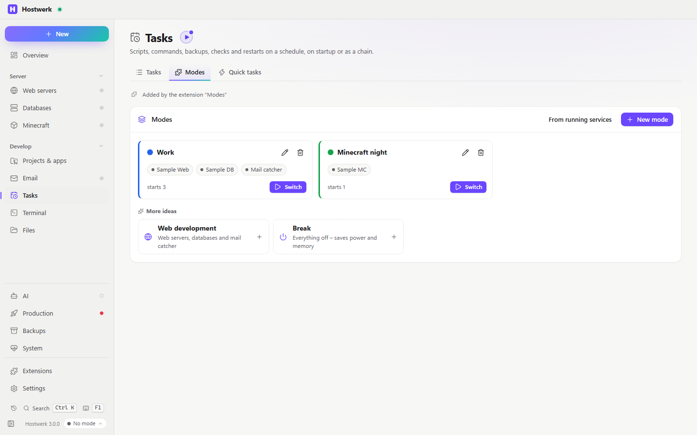

# Modes

Services for one job with one click: “Work” with web server and database, “Minecraft night” with just the server. Switching starts exactly these services and stops the others – also when Hostwerk starts.

[Deutsch](README.de.md) · An official [Hostwerk](https://github.com/Passimoritz/hostwerk-public) extension (SDK 3.3, native extension)



## What it does

- **Where:** Tasks → Modes, the switch on the overview (next to “Customise”) and at the bottom of the sidebar – no own sidebar entry; the full page stays under Extensions → Open
- Put services together into a mode – web servers, databases, mail catcher, mail servers, apps, Minecraft servers and the AI helper
- **Switch with one click:** before switching you see what starts and what stops; databases start first, because websites and apps need them
- **Also at start:** while a mode is active, Hostwerk's autostart starts exactly its services instead of the single autostart switches
- Create a mode **from the running services** – or from ready examples (web development, Minecraft night, apps, break) prefilled with the services on this PC
- Optional **accent colour** of the whole interface while the mode is active – you see at once where you are
- Optional **own sidebar** per mode – your own choice comes back as soon as no such mode is active
- Removing the extension ends the active mode (colour, sidebar and autostart are Hostwerk's own again); the modes themselves stay

For other extensions (service `profiles`):

```js
profiles.activeProfile();   // { id, name, color, services: ['mariadb', 'mc:survival', …] } or null
```

## Install

In Hostwerk: **Extensions → Discover** and click “Install”. If you already used modes in an earlier Hostwerk version (Settings → Modes), the update installs the extension by itself – with all your modes.

Native extensions run as part of Hostwerk (own server and interface part). That is why Hostwerk only installs them from the official catalogue (with checksum) or in developer mode.

## Data

`settings.profiles` – exactly where Hostwerk always kept it. Removing the extension deletes nothing.

## Develop

```bash
node --test tests/modes.test.js      # tests (no running Hostwerk needed)
node build-native.js .               # build the interface (sdk/build-native.js from hostwerk-public)
node check.js . --strict             # same check as the catalogue (sdk/check.js)
```

Interface source in `ui/src`, server part in `server/`. Texts in the code are English, German is in `locales/de.json`.

## License

MIT
